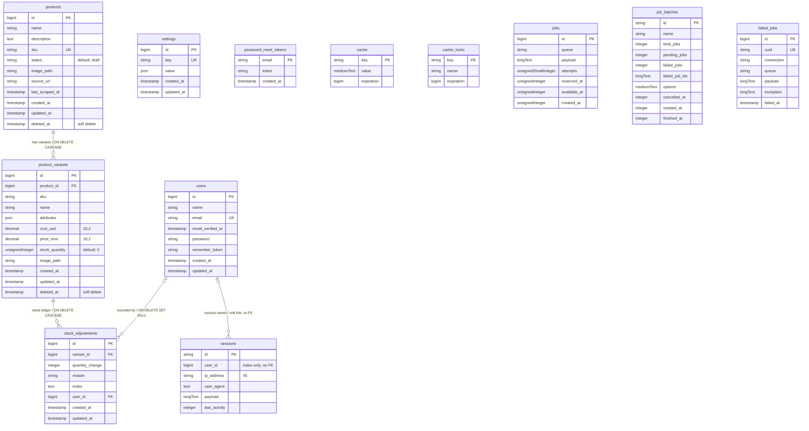

# Arashop — Database Schema

Current database structure as defined by the committed migrations
(`2026-09-07`).

## ER Diagram

## Notes

- **Domain tables**: `products`, `product_variants`, `stock_adjustments`, `settings`.
- **Auth tables**: `users`, `sessions`, `password_reset_tokens` (Laravel default, from the
  `0001_01_01_000000` migration).
- **Framework tables**: `cache`, `cache_locks`, `jobs`, `job_batches`, `failed_jobs`
  (Laravel queue & cache scaffolding; no business relationships).
- `products.sku` and `settings.key` are unique; `settings.value` stores the dotted-key
  config (e.g. `fx.usd_to_mxn`, `pricing.margin_percent`) as JSON.
- `product_variants.attributes` is free-form JSON (`key` → `value`).
- Soft deletes are enabled on `products` and `product_variants` (`deleted_at`).
