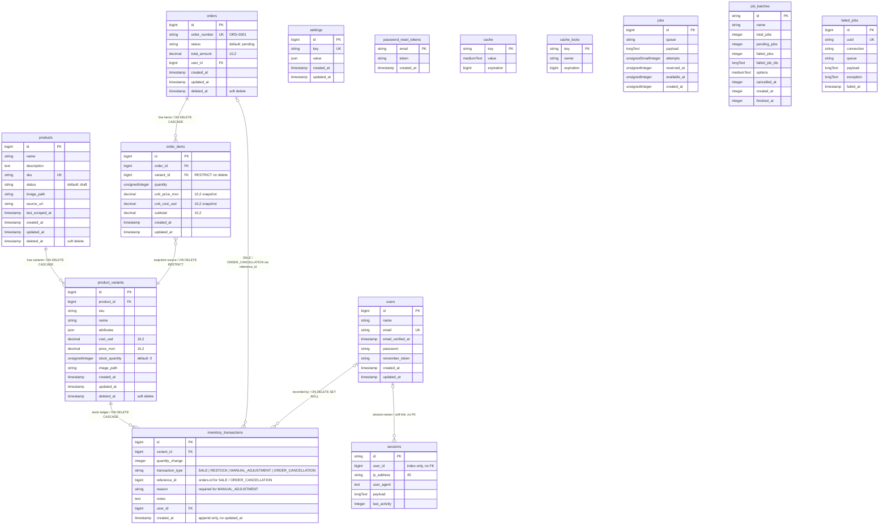

# Arashop — Database Schema

Current database structure as defined by the committed migrations
(`2026-09-11`).

## ER Diagram

## Notes

- **Domain tables**: `products`, `product_variants`, `inventory_transactions`, `orders`,
  `order_items`, `settings`.
- **Auth tables**: `users`, `sessions`, `password_reset_tokens` (Laravel default, from the
  `0001_01_01_000000` migration).
- **Framework tables**: `cache`, `cache_locks`, `jobs`, `job_batches`, `failed_jobs`
  (Laravel queue & cache scaffolding; no business relationships).
- `products.sku` and `settings.key` are unique; `settings.value` stores the dotted-key
  config (e.g. `fx.usd_to_mxn`, `pricing.margin_percent`) as JSON.
- `product_variants.attributes` is free-form JSON (`key` → `value`).
- `inventory_transactions` is an append-only ledger: `created_at` only, no `updated_at`.
  `quantity_change` is positive (restock/cancellation) or negative (sale), the transaction
  type is a string enum, and `reason` is mandated for `MANUAL_ADJUSTMENT`.
- `order_items.unit_price_mxn` / `unit_cost_usd` are immutable snapshots captured at
  checkout, so later price edits never rewrite order history.
- Soft deletes are enabled on `products`, `product_variants`, and `orders` (`deleted_at`).
  `order_items.variant_id` uses `ON DELETE RESTRICT` so variants with order history can
  never be hard-deleted.
